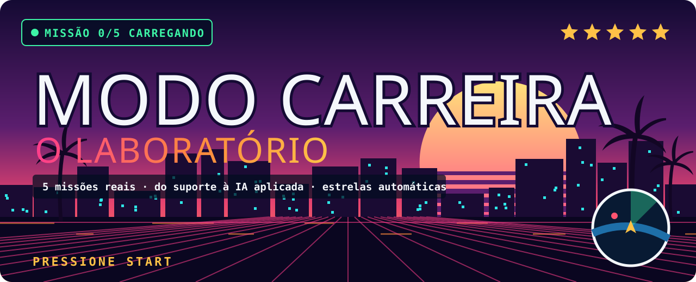
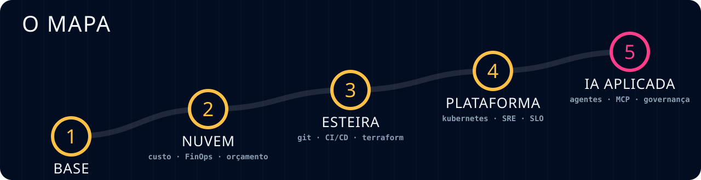
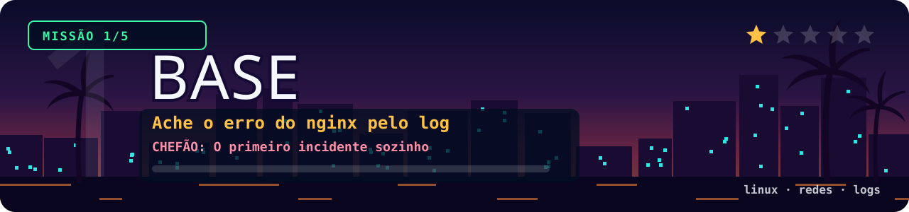
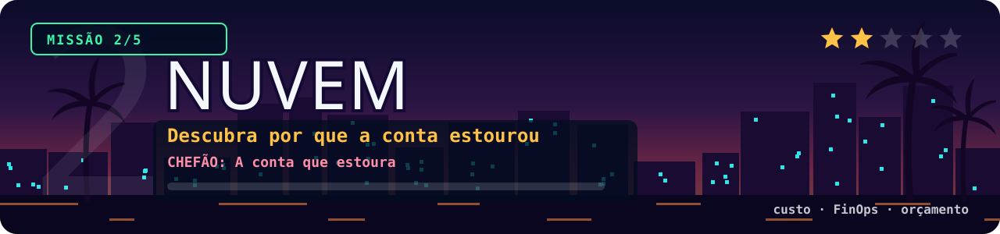
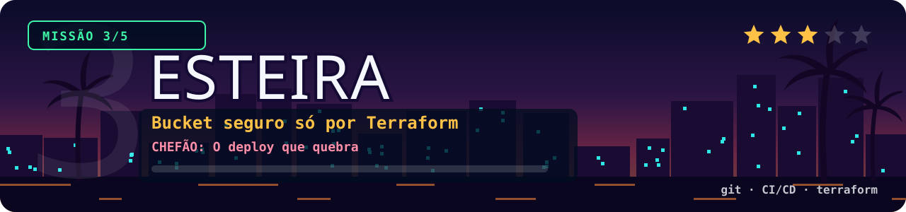
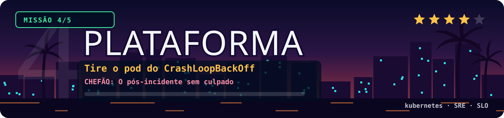
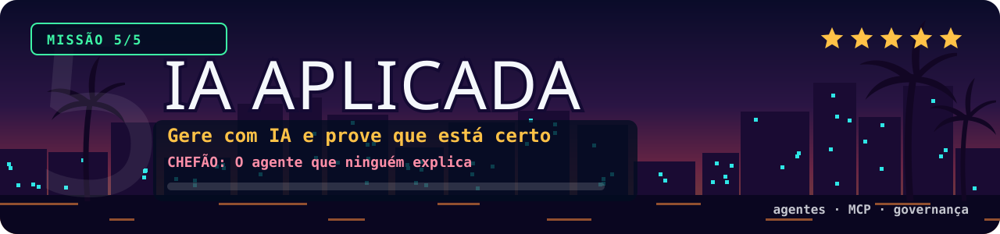

# Modo Carreira · o laboratório

**Cinco missões reais para atravessar o mapa da carreira em tecnologia: do suporte até a IA aplicada.**
Cada missão roda de graça, no seu computador ou no navegador, sem conta na nuvem. Quando você cumpre a missão, a verificação automática do GitHub acende a sua estrela.

| Estrela | Região | Missão | Chefão |
| --- | --- | --- | --- |
|  | 1 · Base | Ache o erro do nginx pelo log e coloque o site no ar | O primeiro incidente sozinho |
|  | 2 · Nuvem | Descubra por que a conta de novembro estourou | A conta que estoura |
|  | 3 · Esteira | Bucket seguro só por Terraform, com o plan rodando no pull request | O deploy que quebra |
|  | 4 · Plataforma | Tire o pod do CrashLoopBackOff num Kubernetes local | O pós-incidente sem culpado |
|  | 5 · IA aplicada | Use Claude, GPT ou outro assistente para gerar código e prove que ele está certo | O agente que ninguém sabe por que fez |

> No seu fork, troque `thiagorpantojaarchitect` nos links das estrelas pelo seu usuário do GitHub para as estrelas aparecerem.

## Como jogar

1. Clique em **Fork** para ter o seu próprio mapa.
2. Abra no navegador: **Code → Codespaces → Create codespace on main**. O ambiente já vem com Docker, kind, kubectl, Terraform e Python. (Ou rode no seu computador com Docker e VS Code + Dev Containers.)
3. Entre na pasta da missão, leia o `MISSAO.md` e resolva.
4. Confira localmente: `python3 scripts/checar.py 1` (troque pelo número da missão).
5. Faça commit e push. A estrela acende quando a verificação passa no GitHub Actions.

## Regras do jogo

- Não existe atalho: a verificação olha o resultado, não o texto.
- Use IA à vontade, mas na missão 5 você precisa explicar cada bloco do que ela gerou.
- Tudo aqui é laboratório com dados fictícios. Nada aponta para uma nuvem de verdade.
- Terminou as 5? Poste o print das estrelas e marque [@euthiagorpantoja](https://www.instagram.com/euthiagorpantoja/).

## Mapa

## As missões

## Créditos

Criado por Thiago Pantoja · [@euthiagorpantoja](https://www.instagram.com/euthiagorpantoja/). Licença MIT.
Claude e GPT são citados só como exemplo de assistente; as marcas pertencem aos seus donos. Este laboratório não tem relação com nenhum jogo ou estúdio. Fontes Anton e JetBrains Mono sob a licença OFL (`assets/fonts`). As artes são geradas por `scripts/gerar_svgs.py` e respeitam a preferência de movimento reduzido.
