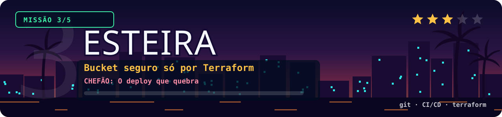

# Missão 3 · Esteira · O deploy que quebra

O time sobe bucket pelo console e cada um configura de um jeito. Na última vez, um bucket ficou público.

## Objetivo
Completar `main.tf` para o bucket ter:
1. versionamento ligado;
2. bloqueio de todo acesso público (os 4 controles).

E fazer isso pela esteira: abra um pull request e veja o `terraform plan` rodar sozinho no GitHub Actions.

## Comandos
```bash
cd missoes/03-esteira
terraform fmt
terraform init
terraform validate
terraform plan
```
Opcional, para aplicar de verdade num S3 falso:
```bash
docker run -d --name localstack -p 4566:4566 localstack/localstack
terraform apply
```

## Conferir
```bash
python3 scripts/checar.py 3
```


Recompensa: ★ Esteira destravada. A verificação lê o plan, não o texto.
